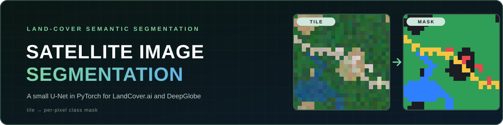
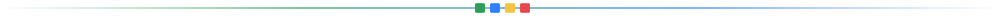
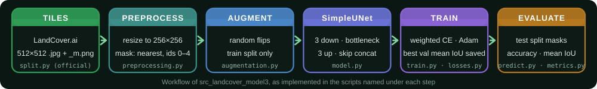
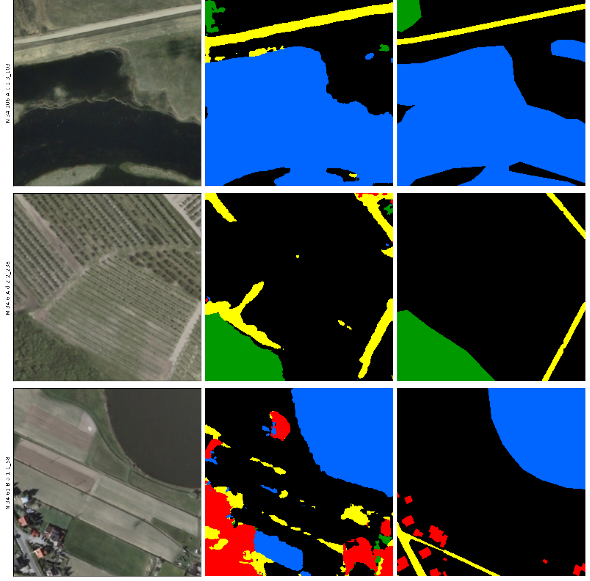

<p align="center">
  
</p>

<p align="center">
  <b>Per-pixel land-cover segmentation of satellite imagery with a small U-Net in PyTorch.</b>
</p>

<p align="center">
  <sub><a href="#overview">Overview</a> · <a href="#implementations">Implementations</a> · <a href="#dataset">Dataset</a> · <a href="#model-and-training">Model</a> · <a href="#prediction-results-ground-truth-vs-model-output">Predictions</a> · <a href="#setup-and-commands">Setup</a> · <a href="#results-and-limitations">Limitations</a></sub>
</p>

## Overview

Given an aerial or satellite tile, the model assigns every pixel to a land-cover class such as woodland, water, road or building. The repository holds three iterations of the same idea: a first pipeline on DeepGlobe and two on LandCover.ai. This README describes the latest one, `src_landcover_model3/`, in detail.

- **Compact model:** a three-level U-Net with 482,101 parameters (5 classes).
- **Class imbalance handling:** class-weighted cross-entropy, plus a script that compares four weighting formulas.
- **Checkpointing:** the best epoch by validation mean IoU is saved.
- **Evaluation tooling:** test-split inference with metrics, training curves, and side-by-side prediction plots.
- **Data checks:** a script that verifies the mask encoding before training.

## Implementations

| | `src/` | `src_landcover_ai/` | `src_landcover_model3/` |
|:---|:---|:---|:---|
| **Dataset** | DeepGlobe | LandCover.ai | LandCover.ai |
| **Classes** | 7 | 5 | 5 |
| **Mask format** | RGB colours mapped through `class_dict.csv` | Single channel, pixel value is the class id | Single channel, pixel value is the class id |
| **Class weights** | Not documented here | Raw inverse frequency (building about 82× background) | Softer weights (building about 9× background) |
| **Known issue** | Collapsed towards a single class | Scattered building and road pixels in plain background | Intended to reduce that speckling; not yet quantified |

The model architecture is shared: `SimpleUNet`, where only the number of classes differs. The `src/` and `src_landcover_ai/` rows are taken from the notes in the model 3 code. Each folder has its own `config.py`, and model 3 writes only to `*_landcover_model3` folders, so the runs never overwrite each other.

<p align="center"></p>

## Dataset

Model 3 expects the LandCover.ai tiles produced by the dataset's official `split.py`, which is not included here. Download the dataset from its official source and run `split.py` inside `landcover.ai_data2/`:

```text
landcover.ai_data2/
  images/  masks/              # original dataset files
  output/                      # 512x512 tiles: <name>.jpg and <name>_m.png
  train.txt  val.txt  test.txt # tile names, one per line, no extension
```

Masks are single-channel PNGs whose pixel value is the class id. The code checks this assumption with `check_mask_values.py`.

| Id | Class | Display colour |
|:---:|:---|:---|
| 0 | background | ⬛ black |
| 1 | building | 🟥 red |
| 2 | woodland | 🟩 green |
| 3 | water | 🟦 blue |
| 4 | road | 🟨 yellow |

## Model and Training

<p align="center"></p>

**Architecture (`model.py`):** a U-Net with three downsampling steps. Each block is two 3×3 convolutions with ReLU. The encoder uses 16, 32 and 64 channels, the bottleneck 128. The decoder upsamples with transposed convolutions and concatenates skip connections, and a final 1×1 convolution outputs one logit per class per pixel. There is no batch normalisation or dropout.

| Setting | Value (`config.py`) |
|:---|:---|
| Input | 256×256 RGB, resized from 512×512 tiles |
| Optimizer | Adam, learning rate 1e-3 |
| Batch size / epochs | 4 / 30 |
| Precision | FP32 (mixed precision off), CUDA if available |
| Checkpoint | `checkpoints_landcover_model3/best_model.pt`, chosen by validation mean IoU |
| Logs | `logs_landcover_model3/history.csv` |

**Preprocessing and augmentation:** images are resized with bilinear interpolation and scaled to 0–1. Masks are resized with nearest-neighbour so class ids are never blended, and ids outside 0–4 are set to 0. Training applies random horizontal and vertical flips (probability 0.5 each) to image and mask together. No other augmentation is used.

**Loss:** `CrossEntropyLoss` with per-class weights `[0.2318, 2.0956, 0.3332, 0.7721, 1.5673]` (background, building, woodland, water, road), chosen from the output of `compute_class_weights.py`, which prints four formulas side by side.

**Metrics (`metrics.py`):** pixel accuracy, and mean IoU over the classes present in each batch. Epoch values are averages of these per-batch scores, not a dataset-wide IoU.

<p align="center"></p>

## Prediction Results: Ground Truth vs Model Output



Each row is a random test tile. The columns are the input satellite tile, the model's predicted mask, and the ground-truth label mask, using the class colours above. Compare shapes and colours between the last two columns to see where the model finds, misclassifies or misses regions.

> This is a qualitative sample from the LandCover.ai pipeline, not a quantitative result, and it says nothing about overall accuracy.

## Setup and Commands

Requires Python and PyTorch. Install the PyTorch build that matches your CUDA setup, then the rest. The scripts use PyTorch, NumPy, Pillow and Matplotlib.

```powershell
python -m venv .venv
.venv\Scripts\Activate.ps1
python -m pip install -r requirements.txt
```

Run everything from the project root. After preparing the dataset:

```powershell
python src_landcover_model3/check_mask_values.py       # confirm masks hold ids 0-4
python src_landcover_model3/compute_class_weights.py   # compare weight formulas, paste a choice into config.py
python src_landcover_model3/train.py                   # trains, saves best_model.pt and history.csv
python src_landcover_model3/plot_history.py            # loss, accuracy and IoU curves
python src_landcover_model3/predict.py                 # test split: predicted masks + test_metrics.csv
python src_landcover_model3/predict.py --image PATH_TO_IMAGE.jpg
python src_landcover_model3/visualize.py               # writes sample_check_landcover.png
python src_landcover_model3/visualize_predictions.py --num_samples 6 --seed 42
```

Outputs go to `checkpoints_landcover_model3/`, `logs_landcover_model3/`, `outputs_landcover_model3/` and `visualize_landcover_model3/`. These are generated locally and kept out of Git.

## Results and Limitations

- **No quantitative results are published here.** `predict.py` writes loss, accuracy and mean IoU on the test split to `logs_landcover_model3/test_metrics.csv`. Report numbers from that file with the implementation name and split.
- **Small model and light augmentation:** about 0.48 M parameters and flips only, so fine structures such as thin roads are hard.
- **Downscaling:** 512×512 tiles are resized to 256×256, which loses detail.
- **Imbalance:** classes are strongly imbalanced. The weights are a trade-off, and weights that are too aggressive caused speckling in the earlier LandCover.ai run.
- **No fixed training seed,** so runs are not exactly reproducible.
- **DeepGlobe:** the original run collapsed towards one class, and its validation split has no ground-truth masks.

## Project Structure

```text
.
├── src/                     # original DeepGlobe pipeline
├── src_landcover_ai/        # first LandCover.ai pipeline
├── src_landcover_model3/    # latest: config, dataset, model, train, predict, metrics, losses, visualisation
├── assets/readme/           # banner, workflow, divider and prediction image
├── requirements.txt
├── sample_check.png · sample_check_landcover.png
└── LandCoverAI_Pipeline_Explained.pdf · image_segmentation_learning_guide.pdf
```

## Possible Improvements

- Report per-class IoU and a dataset-level mean IoU alongside the per-batch average.
- Try stronger augmentation, a deeper encoder or batch normalisation.
- Train at the native 512×512 resolution.
- Seed all random generators for repeatable runs.

## Technologies and Acknowledgements

PyTorch, NumPy, Pillow and Matplotlib. The datasets are DeepGlobe and LandCover.ai; please follow their own licences and citation requirements.

<p align="center"><sub>Built by <b>Pankaj</b> · <a href="https://github.com/Pankaj-Jhajhria/Satellite-Image-Segmentation">Pankaj-Jhajhria/Satellite-Image-Segmentation</a></sub></p>
